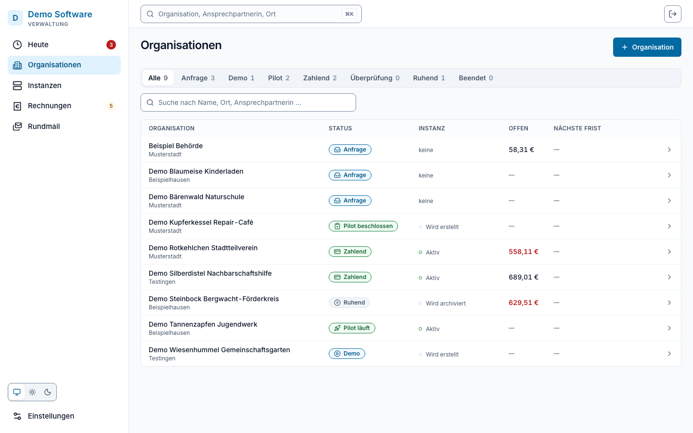
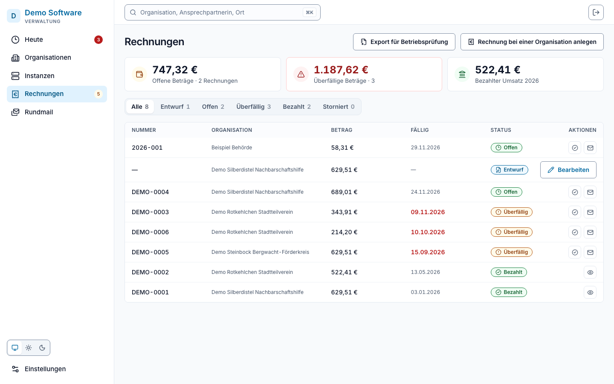
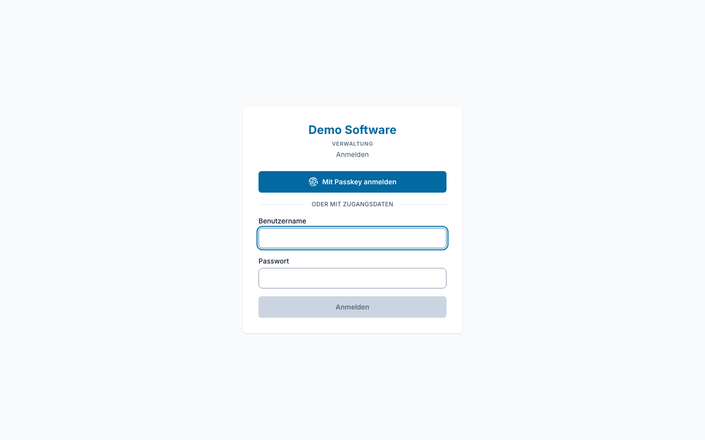
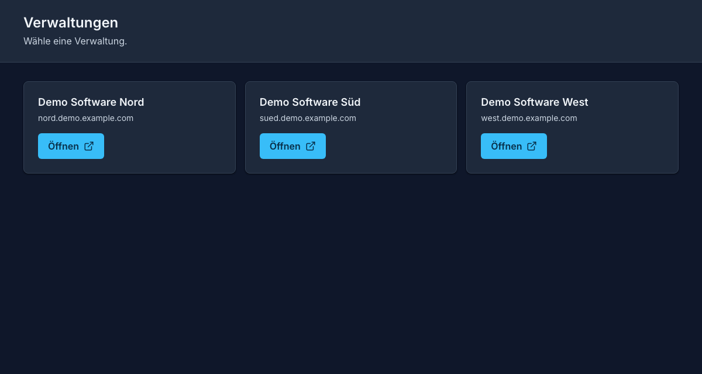
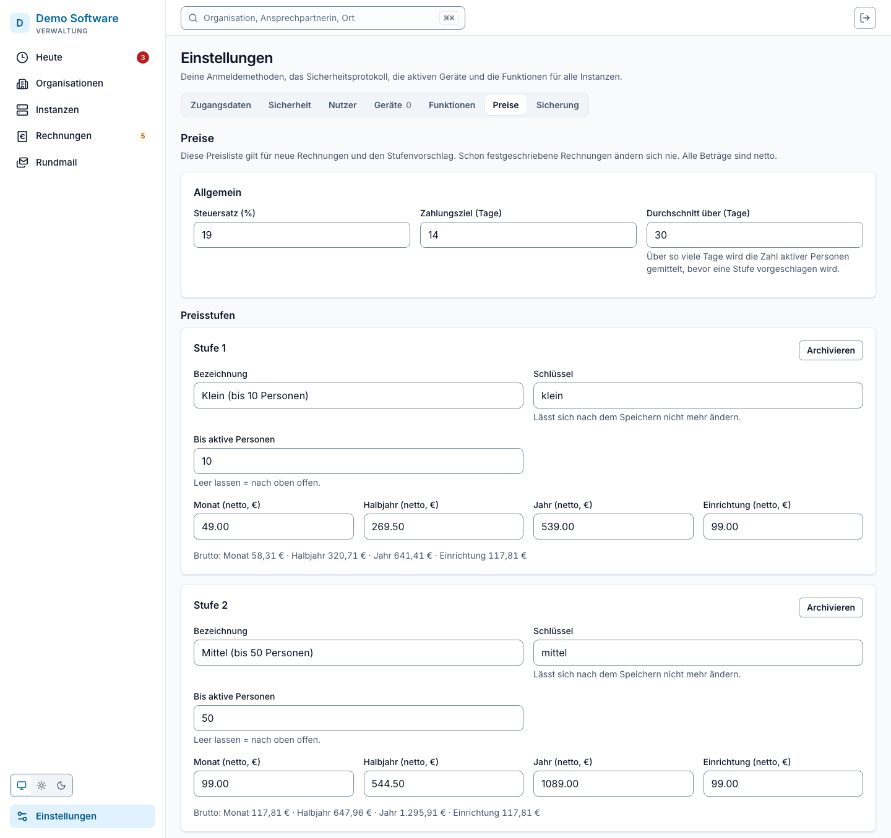
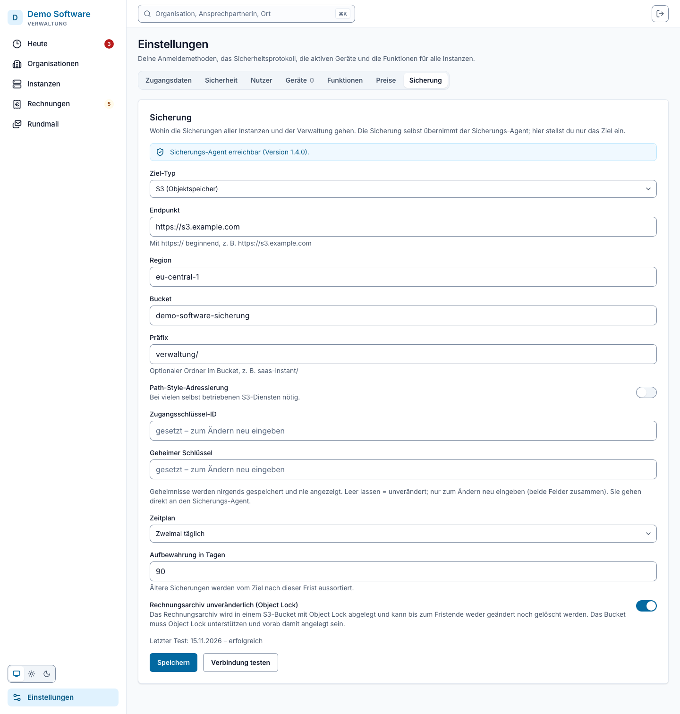
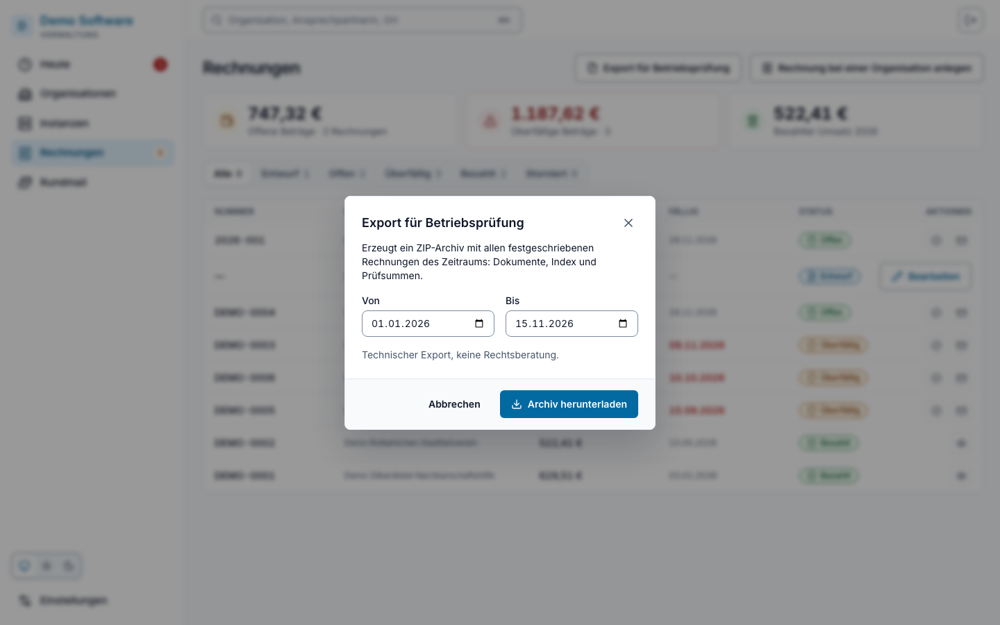

# saas-instant

Self-hostable back office for SaaS software that runs one instance per customer: customers (organisations), their instances and their invoices in one place.

*Deutsche Fassung: [README.md](README.md)*

## What it is

saas-instant is a web application for the operator of a SaaS product. It records who your customers are, creates a dedicated instance of your software for each of them (currently through Coolify), monitors those instances and issues invoices. The software being managed is not part of this repository. It is attached through a manifest (product name, mail, billing, provisioning) and a narrow instance contract.

The control app itself is not multi-tenant: each control app belongs to exactly one software product and has its own database and its own users.

## Who it is for

Operators who offer their own SaaS software as one instance per customer, use Coolify, and would rather not stitch customer records, instances and billing together from several tools. If you run a shared multi-tenant database or do not use Coolify, v1 will not fit (see limitations).

## Features

Everything listed exists in the code. Whether it works in your setup depends on configuration (Coolify access, outgoing mail, invoice renderer).

- **Organisations:** master data, contact persons, notes, history, status lifecycle (inquiry, demo, pilot, paying, review, dormant, ended). A daily schedule (03:00, can be switched off) performs exactly two status changes that have no monetary consequence (pilot to "paying" after 90 days, review seven months after the pilot decision); anything with monetary consequence is only suggested.
- **Inquiry and intake:** a public inquiry endpoint (`POST /api/public/inquiry`, protected by a key) and a token-link intake form for customer details and a direct-debit mandate.
- **Instances:** create through the provisioner (preview, progress, health check), invitation link for first-time setup, reachability check, nightly metrics fetch, nightly reconciliation against Coolify, archiving (stopping). **Backups:** target (S3 or SFTP storage box) in the settings, "back up now", checksum verification, restore into a **new** instance followed by an adoption step (see below and limitations).
- **Invoices:** price tiers (defaults from the manifest, editable as a price list in the settings), draft, finalise (immutable afterwards), send by mail, reminder, payment recording, cancellation, number sequence. **E-invoicing:** EN 16931 (CII) XML is produced by the backend; the PDF/A-3 document (ZUGFeRD/Factur-X, EN 16931 profile) is produced by the `invoice-renderer` service (source in `tools/invoice-renderer`, part of the Compose stack); plus the **XRechnung** as a plain XML file.
- **GoBD building blocks (German tax-audit rules for electronic records):** database triggers block changes to and deletion of finalised invoices and of the audit log; documents are generated once and stored with a SHA-256 checksum; a nightly integrity run with a "document tampered" task; per-invoice history; retention end per invoice (default 8 years); export for tax audits. This is the **technical implementation** only. The process documentation (template in [docs/operations/gobd.md](docs/operations/gobd.md), German) and legal review remain with the operator and their tax adviser.
- **Backup and restore:** a dedicated **backup agent** (container in the Compose stack) backs up instances, the control database and an invoice archive, encrypted (age), to S3 (optionally with Object Lock) or a storage box. Credentials live only in the agent and are write-only in the UI. Details (German): [docs/operations/backup-and-recovery.md](docs/operations/backup-and-recovery.md).
- **Mail:** outgoing mail with a queue, split into transactional mail and marketing broadcasts; broadcasts only with consent (double opt-in, block list).
- **"Today" task list:** derived hints (overdue invoices, missing backup, failed metrics fetch, deviation from Coolify, and so on).
- **Operational switches:** feature flags that instances read via `GET /api/flags`.
- **Sign-in:** passkey, or password plus a second factor (e-mail code, authenticator app or passkey), recovery codes, audit and security log, emergency commands inside the container. Roles: `owner` and `administrator`.

## Screenshots

Taken with the fictitious demo data from `pnpm --filter @saas-instant/control seed:demo` (see [CONTRIBUTING.md](CONTRIBUTING.md)). The design is deliberately neutral (Inter, slate grays, one calm blue accent) and follows the system's light or dark color scheme automatically; it can also be switched by hand in the sidebar. The interface text is German in v1.

| | |
|---|---|
| <br>**Today:** open tasks from invoices and instances | <br>**Companies** with status |
| <br>**Company:** contact, history, next steps | <br>**Instances** per company |
| <br>**Invoices** | <br>**Invoice** with PDF/XML, payment, reminder |
| <br>**Dark mode** | <br>**Sign-in** with passkey or password + second factor |
| <br>**Portal** (mode "portal"): list of the managers | <br>**Portal** in dark mode |
| <br>**Settings → Prices:** tiers, tax rate, payment term | <br>**Settings → Backup:** S3 or storage box |
| <br>**Instance → Backups** | <br>**Restore as a new instance** |
| <br>**Invoice** with ZUGFeRD/XRechnung, integrity, history | <br>**Export for tax audit** |

## Architecture at a glance

```
 Operator ──► control app (one per software)    ┌──────────────┐
              control-web (nginx + UI)          │ Coolify API  │
              control-api (NestJS) ──Provisioner──►            │──► instance, customer A
              control-db  (Postgres)            └──────────────┘──► instance, customer B
                   ▲   │
       manifest ───┘   └── calls each instance: health, setup status, metrics
  (saas-instant.manifest.yaml)                 (instance contract)

 portal mode: additionally a static portal (list + links) in front of several control apps.
```

- **One control app per software.** Each software gets its own control app with its own database and sign-in.
- **Mode fixed at first installation, immutable afterwards:** `single` (exactly one control app) or `portal` (several control apps plus a slim portal that only shows a list and links: no customer data, no sign-in).
- **Provisioner interface:** three operations (create, status, stop); only Coolify in v1.
- **Rule R1, never delete:** the control app knows exactly one database (its own) and has no code path that deletes a deployment or a database. Archiving stops the instance; its data volume stays. A restore always creates a **new** instance; on adoption the old one is stopped, never deleted.
- **Backup agent:** performs backup and restore (the control app only triggers them), HMAC-signed jobs on the internal network, Docker access only through a `docker-socket-proxy` with an allowlist.
- **Manifest:** `saas-instant.manifest.example.yaml` describes the software (name, mail, billing, provisioning, UI).
- **Instance contract:** what a software must provide (three environment variables, one mandatory endpoint, two optional ones).

Details (German): [docs/architecture.md](docs/architecture.md), [docs/manifest.md](docs/manifest.md), [docs/instance-contract.md](docs/instance-contract.md) (has an English summary).

## Requirements

- Docker with Compose v2 (`docker compose`), Docker daemon running
- `openssl` and `bash` (for `install.sh`)
- for instance management: a Coolify installation with an API token, project, server and deploy key, plus a Git repository holding your software's compose definition that satisfies the instance contract
- SMTP access (without it, sign-in codes and instance invitations are not delivered)
- for operation on a network: a TLS-terminating reverse proxy (for example Traefik, Caddy, nginx)

For development additionally Node 22 and pnpm 11 (see `package.json`, `apps/control/Dockerfile`).

## Quick start

```bash
git clone <this repository> saas-instant && cd saas-instant
```

**`single` mode** (one control app, no portal):

```bash
./install.sh --mode single --software my-product
```

**`portal` mode** (several control apps plus portal):

```bash
./install.sh --mode portal --software product-a
bin/saas-instant add product-b        # another control app, portal mode only
```

For each control app `install.sh` creates `installations/<slug>/` (a `.env` with random secrets, permissions 600, plus a copy of the example manifest), writes the mode to `.saas-instant-mode` and starts the containers with `docker compose`. The UI is then at `http://localhost:8080` (further control apps get the next free port; the portal starts at 8090).

Create the first account inside the container; this prints a registration link for a passkey:

```bash
bin/saas-instant emergency my-product first-account admin@example.com "First Last"
```

Then edit `installations/<slug>/saas-instant.manifest.yaml` and restart the control app (the manifest is read only at start-up). `install.sh --dry-run` shows what would happen without writing anything; `--no-start` creates everything but starts no containers.

Step by step, with TLS and proxy notes (German): [docs/installation.md](docs/installation.md).

## Limitations in v1

- **Test status:** unit, integration (real Postgres) and UI tests are green (control: 1465 Jest, 478 Vitest, 452 integration tests; backup agent 50, invoice service 14). In addition, three end-to-end suites run against real containers (`bash tests/e2e/run.sh <backup|invoice|install>`, [tests/e2e/README.md](tests/e2e/README.md)): **backup/restore** (MinIO with Object Lock, SFTP as a storage-box stand-in, mock Coolify; 21 steps), **invoice** (invoice service, ZUGFeRD PDF/A-3b checked with veraPDF, XRechnung and Factur-X rated acceptable by the KoSIT validator, GoBD export verified with `sha256sum -c`, mail via Mailpit; 23 steps) and **install** (`single`, `portal` with a second control instance, binding/slug mismatch, operation behind TLS with Caddy; 34 steps). A sample of the generated invoice (fictitious data): [PDF](docs/examples/rechnung-zugferd-beispiel.pdf), [XRechnung XML](docs/examples/rechnung-xrechnung-beispiel.xml). **Not verified:** mail delivery through a real provider, operation with a real Coolify or a production storage target, acceptance of the invoices by an authority or a tax-advisor system.
- **The backup agent has only been tested against a small Compose mock and stand-in counterparts**, not against a real Coolify installation or a production storage target. Verification in the control app is a checksum of the encrypted file; whether a backup can be decrypted and restored is shown only by a restore drill with your private key (shown once, stored nowhere). The agent's Docker access remains a residual risk ([docs/operations/security-model.md](docs/operations/security-model.md), German).
- **GoBD is not legal advice.** The software provides technical building blocks; whether your overall process complies is for you and your tax adviser to decide. The triggers do not protect against a superuser on the database server; the application's database role should not hold `TRUNCATE` (an operator task, [docs/operations/gobd.md](docs/operations/gobd.md)). The end-to-end suite checks the e-invoice formats with KoSIT and veraPDF (validator configuration: XRechnung 3.0.2); this does not replace validation by the receiving party. UBL as an XRechnung syntax is not part of v1 (CII only).
- **Coolify only** as provisioner. The interface is prepared, but there is no second provider.
- **The Coolify integration has only been tested against a mock**, not against a real Coolify installation. Paths and sequences were taken from a working provisioning script (`reference/provision-tenant.py`) but are not proven. Expect rework on first real use.
- **Backend messages and mail texts are German only.** The UI goes through an i18n layer ([docs/i18n.md](docs/i18n.md)) but only a German dictionary exists.
- **PDF invoices need the invoice service** (`invoice-renderer`, part of the Compose stack, source in `tools/invoice-renderer`, address `RECHNUNGSDIENST_URL`). If it is not running or the variable is set empty, invoices remain as records and XML, but no PDF can be produced.
- **The mode (`single`/`portal`) cannot be changed after first installation.** A different mode needs a fresh installation in an empty directory.
- **Portal addresses** are written by `install.sh` as `http://<host>:<port>`. For control apps behind TLS you must edit `portal/registry.json` yourself; running `install.sh` or `add` again rewrites the file.
- Invoice logic (tax rate, price tiers, legal details) is geared to German conditions; check the output and mandatory details yourself.

## Documentation

| File | Content |
|---|---|
| [docs/installation.md](docs/installation.md) | installation, configuration, TLS and proxy (German) |
| [docs/manifest.md](docs/manifest.md) | all fields of the software manifest (German) |
| [docs/architecture.md](docs/architecture.md) | structure, provisioner, rule R1, modes (German) |
| [docs/instance-contract.md](docs/instance-contract.md) | what a software must provide (German, English summary) |
| [docs/i18n.md](docs/i18n.md) | UI texts |
| [docs/rename-glossary.md](docs/rename-glossary.md) | naming rules (German to English) |
| [docs/operations/](docs/operations/) | operations: backup agent and recovery, GoBD, emergency access, Coolify setup, billing and SEPA, security model (German) |

Contributing: [CONTRIBUTING.md](CONTRIBUTING.md). Reporting vulnerabilities: [SECURITY.md](SECURITY.md). Origin and third-party licenses: [NOTICE](NOTICE).

## License

GNU Affero General Public License v3.0, see [LICENSE](LICENSE). If you offer a modified version over a network, you must make that version's source code available.
